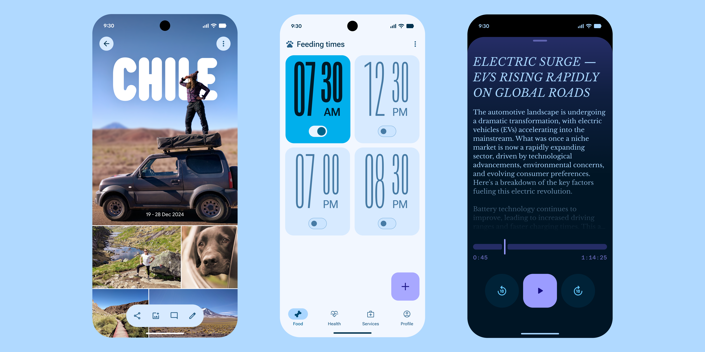

# Awesome Material Apps

A curated list of Android apps that use **Material Design 3**, **Material You**, and modern Material theming.

## About

Awesome Material Apps is an independent, community-driven directory for discovering Android applications that adopt Material Design 3 and Material You. It organizes apps by purpose, links to their primary project pages, and uses clear tags to describe design support. Open-source projects are highlighted, and cross-platform apps are welcome when they have an Android version.

## Contents

- [Social & Communication](#social--communication)
- [Streaming Clients](#streaming-clients)
- [Media Tracking](#media-tracking)
- [Games](#games)
- [Automation & Sync](#automation--sync)
- [Material Design Resources](#material-design-resources)
- [Root & System Management](#root--system-management)
- [Communication Tools](#communication-tools)
- [Email](#email)
- [Launchers](#launchers)
- [Keyboards](#keyboards)
- [Icons & Wallpapers](#icons--wallpapers)
- [Music Players](#music-players)
- [Video Players](#video-players)
- [Podcasts & Audiobooks](#podcasts--audiobooks)
- [Media Servers](#media-servers)
- [Gallery & Image Tools](#gallery--image-tools)
- [Camera Apps](#camera-apps)
- [Audio Recording](#audio-recording)
- [Notes & Tasks](#notes--tasks)
- [Calendars](#calendars)
- [Clocks & Timers](#clocks--timers)
- [Browsers](#browsers)
- [Developer Tools](#developer-tools)
- [AI Assistants](#ai-assistants)
- [Translators](#translators)
- [App Management & Backup](#app-management--backup)
- [ADB & System Tools](#adb--system-tools)
- [Document Scanning & Reading](#document-scanning--reading)
- [Education](#education)
- [Finance](#finance)
- [Home & Shopping](#home--shopping)
- [VPN & Privacy](#vpn--privacy)
- [Download Managers](#download-managers)
- [Maps & Navigation](#maps--navigation)
- [Smart Devices](#smart-devices)
- [Emulators](#emulators)
- [Security & Link Tools](#security--link-tools)
- [File Managers](#file-managers)
- [App Stores](#app-stores)
- [Readers](#readers)
- [Weather](#weather)
- [Calculators](#calculators)
- [Password Managers](#password-managers)
- [2FA Authenticators](#2fa-authenticators)
- [Health & Fitness](#health--fitness)
- [Counters](#counters)
- [Audio Equalizers](#audio-equalizers)
- [Design Tags](#design-tags)
- [Contributing](#contributing)

## Social & Communication

### Reddit & Community

- [Ilay for Reddit](https://github.com/bennybar/LuliReddit) — An open-source Reddit client. `MD3E` `FOSS`
- [Infinity for Reddit](https://github.com/Docile-Alligator/Infinity-For-Reddit) — An open-source Reddit client. `MDY` `FOSS`
- [Pineapple](https://github.com/galaxygoldfish/pineapple) — An open-source Reddit client. `MDY` `FOSS`
- [Summit for Lemmy](https://github.com/idunnololz/summit-for-lemmy) — An open-source client for Lemmy communities. `MD3E` `FOSS`
- [Raccoon for Lemmy](https://github.com/LiveFastEatTrashRaccoon/RaccoonForLemmy) — An open-source Lemmy client. `MDY` `FOSS`

### Social Networks & Messaging

- [Moshidon](https://github.com/LucasGGamerM/moshidon) — An open-source Mastodon client with additional features. `MDY` `FOSS` `FORK`
- [MonoGram](https://github.com/monogram-android/monogram) — An open-source Telegram client. `MD3E` `FOSS`
- [Cherrygram](https://github.com/arsLan4k1390/Cherrygram) — An open-source Telegram client. `MDY` `FOSS`
- [OctoGram](https://github.com/OctoGramApp/OctoGram) — An open-source Telegram client. `MDY` `FOSS`
- [PixEz Flutter](https://github.com/Notsfsssf/pixez-flutter) — An open-source Pixiv client. `MDY` `FOSS`
- [Pixelix](https://github.com/ghostbyte-dev/pixelix) — An open-source Pixelfed client. `MDY` `FOSS`
- [PixelDroid](https://github.com/H-PixelDroid/PixelDroid) — An open-source Pixelfed client. `MDY` `FOSS`

- [Mastodon for Android](https://github.com/mastodon/mastodon-android) — The official Android client for the Mastodon social network. `MDY` `FOSS`
- [Pachli](https://github.com/pachli/pachli-android) — A feature-rich Mastodon client. `MD` `FOSS`
- [Jerboa](https://github.com/dessalines/jerboa) — An Android client for the Lemmy link aggregation platform. `MDY` `FOSS`
- [Thunder](https://github.com/hjiangsu/thunder) — An open-source client for Lemmy. `MDY` `FOSS`
- [FluffyChat](https://github.com/krille-chan/fluffychat) — A Matrix messaging client. `MDY` `FOSS`
- [Signal](https://github.com/signalapp/Signal-Android) — Private messaging and calling. `MD` `FOSS`
- [Molly](https://github.com/mollyim/mollyim-android) — A privacy-focused fork of Signal for Android. `MDY` `FOSS` `FORK`

## Streaming Clients

### Video & Online Media

- [LibreTube](https://github.com/libre-tube/LibreTube) — An open-source alternative YouTube client. `MDY` `FOSS`
- [Flow](https://github.com/A-EDev/Flow) — An open-source client for watching online video content. `MDY` `FOSS`
- [Syncara](https://github.com/khaled-0/Syncara) — An open-source media streaming client. `MDY` `FOSS`
- [Materialious](https://github.com/Materialious/Materialious) — A Material-styled frontend for Invidious. `MD` `FOSS`

### Music Streaming

- [Umihi Music](https://github.com/ilianoKokoro/umihi-music) — An open-source music streaming client. `MD3E` `FOSS`
- [VIVI](https://github.com/vivizzz007/vivi-music) — An open-source music streaming app. `MD3E` `FOSS`
- [Muzza](https://github.com/Maloy-Android/Muzza) — An open-source music streaming client. `MDY` `FOSS`
- [SoundPod](https://github.com/arunnechully/SoundPod) — An open-source music streaming app. `MDY` `FOSS`
- [Metrolist](https://github.com/mostafaalagamy/Metrolist) — An open-source music client based on another project. `MD3E` `FOSS` `FORK`
- [OuterTune](https://github.com/DD3Boh/OuterTune) — An open-source music streaming client. `MDY` `FOSS` `FORK`
- [Musify](https://github.com/gokadzev/Musify) — An open-source music streaming client. `MDY` `FOSS`
- [Youamp](https://github.com/siper/Youamp) — An open-source music streaming app. `MDY` `FOSS`

## Media Tracking

- [Pano Scrobbler](https://github.com/kawaiiDango/pScrobbler) — An open-source music scrobbling client. `MDY` `FOSS`
- [Movie DB](https://github.com/WirelessAlien/MovieDB) — An open-source movie discovery and tracking app. `MDY` `FOSS`
- [Showly](https://github.com/trakt/showly) — An open-source TV show and movie tracker. `MD` `FOSS`
- [AniSync](https://github.com/Marco-9456/AniSync) — An open-source app for synchronizing anime lists. `MD3E` `FOSS`
- [Watch Master](https://github.com/PranshulGG/WatchMaster) — An open-source media tracking app. `MD3E` `FOSS`
- [AniHyou](https://github.com/axiel7/AniHyou-android) — An open-source AniList client. `MDY` `FOSS`
- [Animite](https://github.com/imashnake0/Animite) — An open-source anime tracking app. `MDY` `FOSS`
- [MoeList](https://github.com/axiel7/MoeList) — An open-source anime and manga list client. `MDY` `FOSS`
- [SeriesGuide](https://github.com/UweTrottmann/SeriesGuide) — An open-source TV and movie tracking app. `MDY` `FOSS`
- [Movies](https://github.com/michaelbel/movies) — An open-source movie discovery app. `MDY` `FOSS`

## Games

- [Lichess](https://github.com/lichess-org/mobile) — The open-source mobile app for the Lichess chess platform. `MDY` `FOSS`
- [Libre Sudoku](https://github.com/kaajjo/Libre-Sudoku) — An open-source Sudoku game. `MDY` `FOSS`
- [Antimine](https://github.com/lucasnlm/antimine-android) — An open-source Minesweeper-style puzzle game. `MDY` `FOSS`
- [New Quiz](https://github.com/joaomanaia/newquiz) — An open-source quiz game. `MDY` `FOSS`

## Automation & Sync

- [EasySync](https://github.com/phpbg/easysync) — An open-source file synchronization utility. `MD` `FOSS`
- [vFlow](https://github.com/Chaomixian/vFlow) — An open-source visual automation app. `MDY` `FOSS`
- [Klick'r](https://github.com/Nain57/Smart-AutoClicker) — An open-source smart auto-clicker. `MDY` `FOSS`
- [Round Sync](https://github.com/newhinton/Round-Sync) — An Android client for managing file synchronization with rclone. `MDY` `FOSS`

## Material Design Resources

- [MaterialGallery Android](https://github.com/NUmeroAndDev/MaterialGallery-android) — An app showcasing Material Design components and patterns. `MDY` `FOSS`
- [Monet Color Previewer](https://github.com/Smooth-E/monet-color-previewer) — A tool for previewing Material You color palettes. `MDY` `FOSS`
- [Adaptive Theme](https://github.com/xLexip/Adaptive-Theme) — An open-source utility that switches Android light/dark mode using ambient light and can synchronize wallpapers, with Material You theming. `MDY` `FOSS`

## Root & System Management

- [Shizuku](https://github.com/RikkaApps/Shizuku) — An open-source service that lets supported apps use system APIs with elevated privileges. `MDY` `FOSS`
- [KernelSU](https://github.com/tiann/KernelSU) — An open-source kernel-based root solution for Android. `MDY` `FOSS`
- [APatch](https://github.com/bmax121/APatch) — An open-source kernel-based root solution. `MDY` `FOSS`
- [MMRL](https://github.com/DerGoogler/MMRL) — An open-source manager for root modules. `MDY` `FOSS`

## Communication Tools

- [Connect You](https://github.com/you-apps/ConnectYou) — An open-source contacts and communication app. `MDY` `FOSS`
- [Fossify Contacts](https://github.com/FossifyOrg/Contacts) — A privacy-friendly contacts manager. `MDY` `FOSS`
- [Fossify Phone](https://github.com/FossifyOrg/Phone) — An open-source phone and dialer app. `MDY` `FOSS`
- [Fossify Messages](https://github.com/FossifyOrg/Messages) — An open-source SMS messenger. `MDY` `FOSS`

## Email

- [MonoMail](https://github.com/shrivatsav-0/monomail) — An open-source email client. `MD3E` `FOSS`
- [Aster Mail](https://github.com/Aster-Privacy/Aster-Android) — An open-source email client focused on privacy. `MDY` `FOSS`
- [Infomaniak kMail](https://github.com/Infomaniak/android-kMail) — The Android email app from Infomaniak. `MDY` `FOSS`
- [Thunderbird for Android](https://github.com/thunderbird/thunderbird-android) — An open-source email client for Android. `MD` `FOSS`

## Launchers

- [Kvaesitso](https://github.com/MM2-0/Kvaesitso) — A customizable, search-focused Android launcher. `MDY` `FOSS`
- [Lawnchair](https://github.com/LawnchairLauncher/lawnchair) — A customizable launcher inspired by the Pixel Launcher. `MDY` `FOSS`
- [Fossify Launcher](https://github.com/FossifyOrg/Launcher) — A lightweight, open-source home screen launcher. `MDY` `FOSS`

## Keyboards

- [Fossify Keyboard](https://github.com/FossifyOrg/Keyboard) — An open-source keyboard app. `MDY` `FOSS`
- [HeliBoard](https://github.com/Helium314/HeliBoard) — A privacy-conscious, open-source keyboard. `MDY` `FOSS`
- [FlorisBoard](https://github.com/florisboard/florisboard) — An extensible open-source keyboard. `MDY` `FOSS`

## Icons & Wallpapers

- [Lawnicons](https://github.com/LawnchairLauncher/lawnicons) — An open-source icon pack for Android launchers. `MD3E` `FOSS`
- [Arcticons](https://github.com/Donnnno/Arcticons) — An open-source line icon pack. `MDY` `FOSS`
- [Paperize](https://github.com/Anthonyy232/Paperize) — An open-source wallpaper app. `MDY` `FOSS`
- [WallYou](https://github.com/you-apps/WallYou) — An open-source wallpaper app. `MDY` `FOSS`

## Music Players

- [PixelPlayer](https://github.com/theovilardo/PixelPlayer) — An open-source local music player. `MD3E` `FOSS`
- [Rhythm](https://github.com/cromaguy/Rhythm) — An open-source music player. `MD3E` `FOSS`
- [Chocola](https://github.com/sosauce/Chocola) — An open-source music player. `MD3E` `FOSS`
- [Harmonoid](https://github.com/harmonoid/harmonoid) — A music player and library manager. `MDY` `FOSS`
- [Booming Music](https://github.com/ProjectOrbital/BoomingMusic) — An open-source music player. `MDY` `FOSS`
- [Retro Music Player](https://github.com/RetroMusicPlayer/RetroMusicPlayer) — An open-source music player with a customizable interface. `MDY` `FOSS`
- [Auxio](https://github.com/OxygenCobalt/Auxio) — A lightweight local music player. `MDY` `FOSS`
- [Fossify Music Player](https://github.com/FossifyOrg/Music-Player) — A privacy-friendly local music player. `MDY` `FOSS`
- [Gramophone](https://github.com/AkaneTan/Gramophone) — An open-source local music player. `MDY` `FOSS`
- [SuvMusic](https://github.com/suvojeet-sengupta/SuvMusic) — An open-source Android music app with local and streamed playback, Material 3 UI, and Material You dynamic colors. `MDY` `FOSS`

## Video Players

- [Next Player](https://github.com/anilbeesetti/nextplayer) — An open-source video player. `MDY` `FOSS`
- [mpvEx](https://github.com/marlboro-advance/mpvEx) — An mpv-based Android video player. `MD3E` `FOSS`
- [Aperture](https://github.com/XDanfr/Aperture) — An open-source Android TV media player with Material 3 Expressive UI and Material You dynamic color support. `MD3E` `FOSS`
- [Asuka Player](https://github.com/qianmokano/Asukaplayer) — An open-source local video player built with Jetpack Compose, Material 3, and Android dynamic color theming. `MDY` `FOSS`

## Notes & Tasks

- [Nouto](https://github.com/HotarunIchijou/Nouto) — An open-source note-taking app. `MD3E` `FOSS`
- [Lockbook](https://github.com/lockbook/lockbook) — An end-to-end encrypted note-taking app. `MD3E` `FOSS`
- [Saber](https://github.com/adil192/saber) — An open-source handwriting and note-taking app. `MDY` `FOSS`
- [Moe Memos](https://github.com/mudkipme/MoeMemosAndroid) — An Android client for the Memos note-taking service. `MDY` `FOSS`
- [jtx Board](https://github.com/TechbeeAT/jtxBoard) — A journal, task, and calendar app. `MDY` `FOSS`

## Calendars

- [Fossify Calendar](https://github.com/FossifyOrg/Calendar) — A privacy-friendly calendar app. `MDY` `FOSS`
- [KashCal](https://github.com/KashCal/KashCal) — An open-source calendar app. `MDY` `FOSS`
- [Persian Calendar](https://github.com/persian-calendar/persian-calendar) — An open-source Persian calendar app. `MDY` `FOSS`

## Clocks & Timers

- [Tomato](https://github.com/nsh07/Tomato) — A Pomodoro timer. `MD3E` `FOSS`
- [Cofi](https://github.com/rozPierog/Cofi) — A focus timer for productivity sessions. `MD3E` `FOSS`
- [Clock You](https://github.com/you-apps/ClockYou) — An open-source clock and alarm app. `MDY` `FOSS`
- [Fossify Clock](https://github.com/FossifyOrg/Clock) — An open-source clock, alarm, and timer app. `MDY` `FOSS`

## Browsers

- [Cromite](https://github.com/uazo/cromite) — A privacy-oriented Chromium-based browser. `MDY` `FOSS` `FORK`
- [Thorium](https://github.com/Alex313031/Thorium-Android) — A Chromium-based browser project for Android. `MDY` `FOSS`
- [WebLibre](https://github.com/FaFre/WebLibre) — An open-source privacy-focused browser. `MDY` `FOSS`
- [Fulguris](https://github.com/Slion/Fulguris) — An open-source Android web browser. `MD` `FOSS`

## Developer Tools

- [Cosmic IDE](https://github.com/Cosmic-Ide/Cosmic-Ide) — An open-source IDE for Android. `MDY` `FOSS`
- [Xed Editor](https://github.com/Xed-Editor/Xed-Editor) — An open-source text and code editor. `MDY` `FOSS`

## AI Assistants

- [RikkaHub](https://github.com/rikkahub/rikkahub) — An open-source AI chat client supporting multiple providers. `MDY` `FOSS`
- [AI Hub](https://github.com/SilentCoderHere/aihub) — An open-source AI chat application. `MDY` `FOSS`

## Translators

- [Translate You](https://github.com/you-apps/TranslateYou) — An open-source translation app. `MDY` `FOSS`

## Podcasts & Audiobooks

- [AntennaPod](https://github.com/AntennaPod/AntennaPod) — An open-source podcast manager and player. `MDY` `FOSS`
- [PodAura](https://github.com/SkyD666/PodAura) — An open-source podcast app. `MDY` `FOSS`
- [Voice](https://github.com/PaulWoitaschek/Voice) — An open-source audiobook player. `MDY` `FOSS`

## Media Servers

- [Findroid](https://github.com/jarnedemeulemeester/findroid) — A third-party Android client for Jellyfin. `MDY` `FOSS`
- [StashFlow](https://github.com/Alchemist-Aloha/StashFlow) — An open-source app for managing a Stash media library. `MDY` `FOSS`

## Gallery & Image Tools

- [Photon Gallery](https://github.com/RomanK2311/Photon_Gallery) — An open-source photo gallery. `MD3E` `FOSS`
- [Lavender Photos](https://github.com/kaii-lb/LavenderPhotos) — An open-source photo gallery. `MDY` `FOSS`
- [Fossify Gallery](https://github.com/FossifyOrg/Gallery) — A privacy-friendly photo and video gallery. `MDY` `FOSS`
- [PhotoPrism Gallery](https://github.com/Radiokot/photoprism-android-client) — An Android client for PhotoPrism. `MDY` `FOSS`
- [Immich](https://github.com/immich-app/immich) — A self-hosted photo and video backup solution with a mobile app. `MDY` `FOSS`
- [Image Toolbox](https://github.com/T8RIN/ImageToolbox) — An open-source image editing and processing toolkit. `MD3E` `FOSS`
- [Easy Watermark](https://github.com/rosuH/EasyWatermark) — An open-source image watermarking app. `MDY` `FOSS`
- [ExifEraser](https://github.com/Tommy-Geenexus/exif-eraser) — An open-source tool for removing metadata from images. `MDY` `FOSS`

## Camera Apps

- [Fossify Camera](https://github.com/FossifyOrg/Camera) — An open-source camera app. `MDY` `FOSS`
- [Libre Camera](https://github.com/iakmds/librecamera) — An open-source camera app. `MD` `FOSS`

## Audio Recording

- [Recording Studio](https://github.com/Leonidius20/RecordingStudio) — An open-source audio recording app. `MDY` `FOSS`
- [Fossify Recorder](https://github.com/FossifyOrg/Voice-Recorder) — An open-source voice recorder. `MDY` `FOSS`
- [Record You](https://github.com/you-apps/recordYou) — An open-source audio recorder. `MDY` `FOSS`
- [MicYou](https://github.com/LanRhyme/MicYou) — An open-source microphone and recording app. `MD3E` `FOSS`
- [Audire](https://github.com/alexmercerind/audire) — An open-source audio recording and listening utility. `MDY` `FOSS`

## App Management & Backup

- [App Manager](https://github.com/MuntashirAkon/AppManager) — An advanced open-source Android app manager. `MDY` `FOSS`
- [Hail](https://github.com/aistra0528/Hail) — An open-source tool for disabling, hiding, and freezing Android apps. `MDY` `FOSS`
- [Android DataBackup](https://github.com/XayahSuSuSu/Android-DataBackup) — An open-source Android app data backup utility. `MDY` `FOSS`
- [Neo Backup](https://github.com/NeoApplications/Neo-Backup) — An open-source backup app for Android. `MDY` `FOSS`
- [Restoid](https://github.com/hddq/restoid) — An open-source Android backup utility. `MDY` `FOSS`

## ADB & System Tools

- [aShell You](https://github.com/DP-Hridayan/ashell) — An Android shell interface for running ADB commands. `MDY` `FOSS`
- [LogFox](https://github.com/F0x1d/LogFox) — An open-source Android log viewer. `MDY` `FOSS`
- [RebootNya](https://github.com/daisukiKaffuChino/RebootNya) — An open-source reboot and device utility. `MD` `FOSS`
- [LibChecker](https://github.com/LibChecker/LibChecker) — An open-source app for inspecting libraries used by Android apps. `MDY` `FOSS`
- [Data Monitor](https://github.com/itsdrnoob/DataMonitor) — An open-source network usage monitor. `MDY` `FOSS`
- [Fern](https://github.com/wized2/Fern) — An open-source offline system monitor for Android, covering CPU, memory, battery, thermals, and network activity with Material You theming. `MDY` `FOSS`

## Document Scanning & Reading

- [OSS Document Scanner](https://github.com/Akylas/OSS-DocumentScanner) — An open-source document scanning app. `MDY` `FOSS`
- [Areada](https://github.com/iTsMe-Zen/Areada) — An open-source document and reading app. `MDY` `FOSS`
- [Episteme Reader](https://github.com/Aryan-Raj3112/episteme) — An open-source document reader. `MDY` `FOSS`

## Education

- [freeDictionaryApp](https://github.com/yamin8000/freeDictionaryApp) — An open-source dictionary app. `MDY` `FOSS`
- [Kanji Dojo](https://github.com/syt0r/Kanji-Dojo) — An open-source Japanese kanji learning app. `MD` `FOSS`
- [Atomic - Periodic Table](https://github.com/JLindemann42/Atomic-Periodic-Table.Android) — An open-source periodic table app. `MDY` `FOSS`

## Finance

- [Cashiro](https://github.com/ritesh-kanwar/Cashiro) — An open-source personal finance tracker. `MD3E` `FOSS`
- [Monekin](https://github.com/enrique-lozano/Monekin) — An open-source personal finance manager. `MDY` `FOSS`
- [Waterfly III](https://github.com/dreautall/waterfly-iii) — An open-source mobile client for Firefly III. `MD` `FOSS`
- [Expensy](https://github.com/mina-android/Expensy) — An open-source expense tracker. `MD` `FOSS`
- [FossWallet](https://github.com/SeineEloquenz/fosswallet) — An open-source wallet and finance app. `MDY` `FOSS`

## Home & Shopping

- [Grocy](https://github.com/patzly/grocy-android) — An Android client for the Grocy household management system. `MDY` `FOSS`
- [kitshn](https://github.com/aimok04/kitshn) — An open-source client for the Mealie recipe manager. `MDY` `FOSS`
- [KitchenOwl](https://github.com/tombursch/kitchenowl) — An open-source shopping list and recipe manager. `MDY` `FOSS`
- [FoodYou](https://github.com/maksimowiczm/FoodYou) — An open-source food and nutrition tracking app. `MDY` `FOSS`
- [Algidy](https://github.com/NhuHuy-79/Algidy) — An open-source food-expiry tracker with barcode scanning, freshness analytics, and Material 3 Expressive UI. `MD3E` `FOSS`
- [Deliveries](https://github.com/itsvic-dev/deliveries) — An open-source parcel tracker for multiple carriers with Material 3 and Android dynamic color support. `MDY` `FOSS`

## VPN & Privacy

- [sing-box](https://github.com/SagerNet/sing-box) — A universal proxy platform with an Android client. `MDY` `FOSS`
- [Proton VPN](https://github.com/ProtonVPN/android-app) — An open-source VPN app. `MD` `FOSS`

## Download Managers

- [Seal](https://github.com/JunkFood02/Seal) — An open-source video and audio downloader interface for yt-dlp. `MDY` `FOSS`
- [YTDLnis](https://github.com/deniscerri/ytdlnis) — An open-source media downloader based on yt-dlp. `MDY` `FOSS`
- [qBitController](https://github.com/Bartuzen/qBitController) — An open-source remote client for qBittorrent. `MDY` `FOSS`
- [Tremotesf](https://github.com/equeim/tremotesf-android) — An open-source remote client for Transmission. `MDY` `FOSS`
- [qBittorrent Manager](https://github.com/Yash-Garg/qBittorrent-Manager) — An Android remote client for qBittorrent. `MD` `FOSS`

## Maps & Navigation

- [BTC Map](https://github.com/teambtcmap/btcmap-android) — An open-source map for discovering Bitcoin-accepting merchants. `MDY` `FOSS`
- [Tridenta](https://github.com/Stypox/tridenta) — An open-source public transport app. `MDY` `FOSS`
- [Transport You](https://github.com/you-apps/TransportYou) — An open-source public transport app. `MDY` `FOSS`
- [CoMaps](https://github.com/comaps/comaps) — An open-source offline maps and navigation app. `MD` `FOSS` `FORK`
- [Trail Sense](https://github.com/kylecorry31/Trail-Sense) — An open-source outdoor navigation and survival tool. `MD` `FOSS`
- [EVMap](https://github.com/ev-map/EVMap) — An open-source map for electric vehicle charging stations. `MD` `FOSS`

## Smart Devices

- [AirSync](https://github.com/sameerasw/airsync-android) — An open-source companion app for connecting devices and sharing files. `MD3E` `FOSS`
- [Tellyscope](https://github.com/man15h/tellyscope) — An open-source Android TV remote and discovery app. `MD3E` `FOSS`
- [Octi](https://github.com/d4rken-org/octi) — An open-source companion app for managing supported devices. `MD` `FOSS`
- [CAPod](https://github.com/d4rken-org/capod) — An open-source companion app for AirPods on Android. `MD` `FOSS`
- [Gadgetbridge](https://codeberg.org/Freeyourgadget/Gadgetbridge) — An open-source companion app for wearable devices. `MDY` `FOSS`
- [KDE Connect](https://invent.kde.org/network/kdeconnect-android) — Connects Android devices with desktops and other devices. `MDY` `FOSS`
- [AdGuard Home Manager](https://github.com/JGeek00/adguard-home-manager) — An open-source Android client for AdGuard Home. `MDY` `FOSS`
- [My Server Status](https://github.com/JGeek00/server-status-android) — An Android app for monitoring server status. `MDY` `FOSS`

## Emulators

- [Lemuroid](https://github.com/Swordfish90/Lemuroid) — An open-source multi-system emulator frontend. `MDY` `FOSS`
- [Dolphin Emulator](https://github.com/dolphin-emu/dolphin) — An open-source emulator for GameCube and Wii. `MDY` `FOSS`
- [Lime3DS](https://github.com/Lime3DS/Lime3DS) — An open-source Nintendo 3DS emulator. `MDY` `FOSS`

## Security & Link Tools

- [Permission Pilot](https://github.com/d4rken-org/permission-pilot) — An open-source app for inspecting and managing Android app permissions. `MD` `FOSS`
- [AirGuard](https://github.com/seemoo-lab/AirGuard) — An open-source app that detects unwanted Bluetooth tracking devices. `MDY` `FOSS`
- [Basic Call Recorder](https://github.com/chenxiaolong/BCR) — An open-source call recording app for supported Android devices. `MDY` `FOSS`
- [Amarok Hider](https://github.com/deltazefiro/Amarok-Hider) — An open-source file and app hiding tool. `MDY` `FOSS`
- [AstraCrypt](https://github.com/gromif/AstraCrypt) — An open-source file encryption app. `MDY` `FOSS`
- [LinkSheet](https://github.com/1fexd/LinkSheet) — An open-source link handling and redirect tool. `MDY` `FOSS`
- [Tarnhelm](https://github.com/lz233/Tarnhelm) — An open-source link cleaner. `MDY` `FOSS`
- [Untracker](https://github.com/zhanghai/Untracker) — An open-source tool for removing tracking parameters from links. `MDY` `FOSS`

## File Managers

- [Material Files](https://github.com/zhanghai/MaterialFiles) — An open-source file manager with a Material You interface. `MDY` `FOSS`
- [Fossify File Manager](https://github.com/FossifyOrg/File-Manager) — A privacy-friendly file manager from the Fossify suite. `MDY` `FOSS`

## App Stores

- [Droid-ify](https://github.com/Iamlooker/Droid-ify) — A modern client for browsing and installing apps from F-Droid repositories. `MDY` `FOSS`
- [Neo Store](https://github.com/NeoApplications/Neo-Store) — An alternative F-Droid client with a modern Material interface. `MDY` `FOSS`

## Readers

- [News](https://github.com/bubelov/news) — An open-source RSS and news reader. `MDY` `FOSS`
- [Twine](https://github.com/msasikanth/twine) — An open-source RSS reader. `MDY` `FOSS`

- [ReadYou](https://github.com/Ashinch/ReadYou) — An open-source RSS reader with a Material You design. `MDY` `FOSS`
- [Feeder](https://github.com/spacecowboy/Feeder) — An open-source RSS reader for following news feeds. `MDY` `FOSS`

## Weather

- [WeatherMaster](https://github.com/PranshulGG/WeatherMaster) — An open-source weather forecast app. `MDY` `FOSS`
- [WeatherWise](https://github.com/MGAndroidProjects/WeatherWise-Releases) — A Material You weather app. `MDY`
- [Overmorrow](https://github.com/bmaroti9/Overmorrow) — An open-source weather forecast app. `MDY` `FOSS`
- [GeoWeather](https://github.com/FreetimeMaker/GeoWeather) — An open-source weather app. `MDY` `FOSS`
- [Rain](https://github.com/DarkMooNight/Rain) — An open-source weather app. `MD` `FOSS`
- [Breezy Weather](https://github.com/breezy-weather/breezy-weather) — An open-source, feature-rich weather app. `MDY` `FOSS`
- [Bura](https://github.com/davidtakac/bura) — An open-source weather app with a clean Material interface. `MDY` `FOSS`

## Calculators

- [Vanilla](https://github.com/sosauce/Vanilla) — An open-source calculator. `MD3E` `FOSS`
- [Currencies](https://github.com/sal0max/currencies) — An open-source currency converter. `MDY` `FOSS`
- [Multi Calculator](https://github.com/YangDai-Github/Multi-Calculator-Android) — An open-source multi-function calculator. `MDY` `FOSS`
- [Unitto](https://github.com/sadellie/unitto) — A calculator and unit converter in one app. `MDY` `FOSS`
- [OpenCalc](https://github.com/Darkempire78/OpenCalc) — An open-source calculator with a Material You interface. `MDY` `FOSS`
- [Calculator M3](https://github.com/gergelyvagujhelyi/CalculatorM3) — An open-source calculator with Material 3, wallpaper-based dynamic colors, and an optional on-device AI math solver. `MDY` `FOSS`

## Password Managers

- [OpenKey](https://github.com/OpenSelfHosting/OpenKey) — An open-source, self-hosted password manager with an encrypted offline vault and optional self-hosted sync. Its Flutter app uses Material 3 ([theme implementation](https://github.com/OpenSelfHosting/OpenKey/blob/main/lib/src/core/theme/app_theme.dart)). `MD` `FOSS`

## 2FA Authenticators

- [Tokn](https://github.com/tokn-authenticator/tokn) — An open-source two-factor authentication app. `MD3E` `FOSS`
- [Stratum](https://github.com/stratumauth/app) — An open-source authenticator for generating one-time codes. `MDY` `FOSS`
- [Mauth](https://github.com/X1nto/Mauth) — An open-source two-factor authentication app. `MDY` `FOSS`
- [Aegis Authenticator](https://github.com/beemdevelopment/Aegis) — An open-source authenticator with encrypted vault storage. `MDY` `FOSS`
- [Yubico Authenticator](https://github.com/Yubico/yubioath-flutter) — An open-source authenticator for YubiKey devices. `MD` `FOSS`
- [2FAS for Android](https://github.com/twofas/2fas-android) — An open-source two-factor authentication app. `MD` `FOSS`

## Health & Fitness

- [Caffeine Health](https://github.com/ohuc/CaffeineHealth) — An open-source caffeine intake tracker. `MD3E` `FOSS`
- [LibreFit](https://github.com/LibreFitOrg/LibreFit) — An open-source fitness and health tracking app. `MD3E` `FOSS`
- [Trainable](https://github.com/Emanuel5014/Trainable) — An open-source workout tracking app. `MD3E` `FOSS`
- [Flexify](https://github.com/brandonp2412/Flexify) — An open-source exercise and fitness tracker. `MDY` `FOSS`
- [Just Another Workout Timer](https://github.com/blockbasti/just_another_workout_timer) — An open-source interval timer for workouts. `MDY` `FOSS`
- [wger](https://github.com/wger-project/flutter) — An open-source fitness and workout management app. `MD` `FOSS`
- [Weight Tracker](https://github.com/AdityaHebballe/Weight-Tracker) — An open-source weight tracking app. `MD3E` `FOSS`
- [Table Habit](https://github.com/FriesI23/mhabit) — An open-source habit tracker. `MDY` `FOSS`
- [Habo](https://github.com/xpavle00/Habo) — An open-source habit tracking app. `MD` `FOSS`

## Counters

- [Simple Counter](https://github.com/quicksc0p3r/simplecounter) — An open-source tally counter. `MDY` `FOSS`
- [Decisioninja](https://github.com/Giuig/decisioninja) — An open-source decision helper with a counter-style interface. `MDY` `FOSS`

## Audio Equalizers

- [RootlessJamesDSP](https://github.com/thepbone/RootlessJamesDSP) — An open-source audio processing and equalizer app for Android. `MDY` `FOSS`

## Design Tags

| Tag | Meaning |
| --- | --- |
| `MD` | Uses Material Design 3. Dynamic color support is not confirmed. |
| `MDY` | Uses Material Design 3 and supports Material You dynamic colors. |
| `MD3E` | Uses Material 3 Expressive design with dynamic color support. |
| `FOSS` | Free and open-source software. |
| `FORK` | A project based on another codebase, with modifications. |

Design support can vary by app version, Android version, and device. Tags describe the listed app's reported support and should be rechecked when entries are updated.

## Contributing

Contributions are welcome. Before opening a pull request:

1. Make sure the app has an Android version.
2. Confirm that it uses Material Design 3, Material You, or supported dynamic theming. A Material-looking icon or screenshot alone is not enough.
3. Add the app under the most relevant category.
4. Include the official project or store link and the correct design tags.
5. Keep descriptions short, factual, and neutral.

Please do not add apps solely because they are popular or because they use Android. The Material design requirement is the focus of this list.

## References

- [Material You App List](https://github.com/nyas1/Material-You-app-list) — A useful community-maintained reference for apps that support Material You.
- [Material Design 3](https://m3.material.io/) — Official Material Design guidance.
